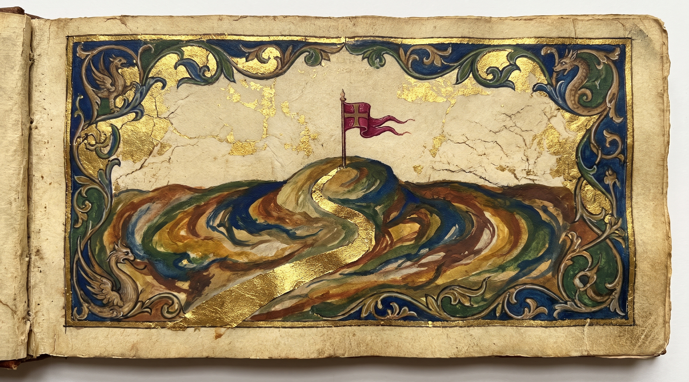
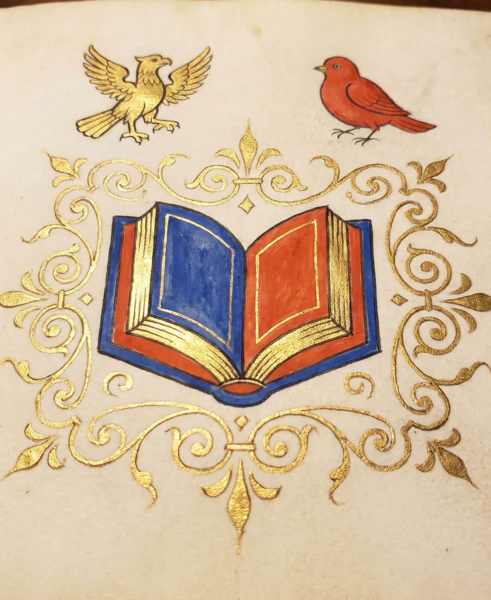
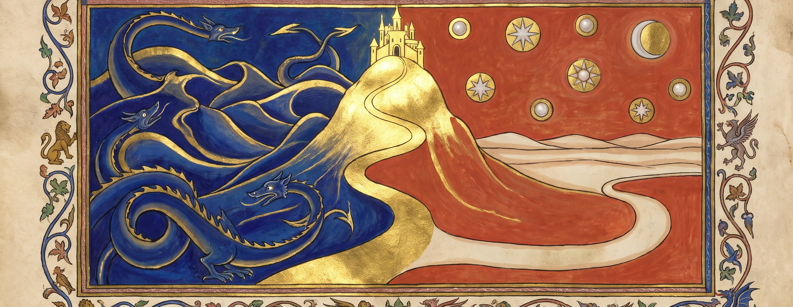

# Favorite-Linux-Distributions

<p align="center"></p>




Garuda Linux KDE and Pop!_OS Cosmic Desktop

```
https://garudalinux.org/
https://system76.com/pop/
```

This repo is a short list of picks, not code. The
Favorite-Linux-Distributions-Website folder holds a static field-guide
page presenting the same picks; it runs no installer and changes no
system.

> **Cataloguer slip.** NOT A DOWNLOADABLE DISTRIBUTION

I keep this list short on purpose. The two setups above are the ones I
like most, one with the KDE desktop and one with the Cosmic desktop. My
pick below is what I get when I put those two choices together: Garuda,
but with Cosmic instead of KDE.

# Ultimate OS:
Garuda Linux Cosmic Desktop
